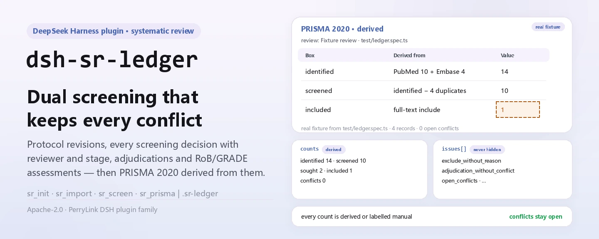
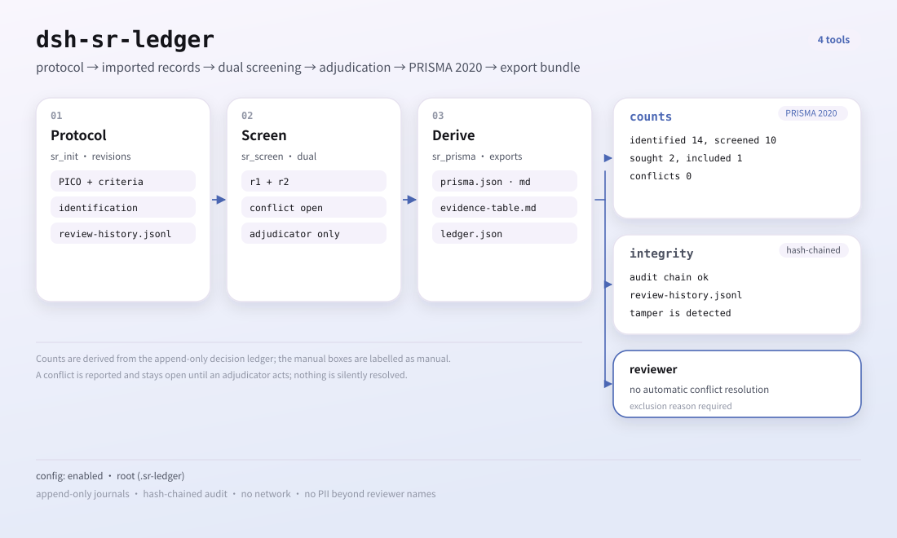
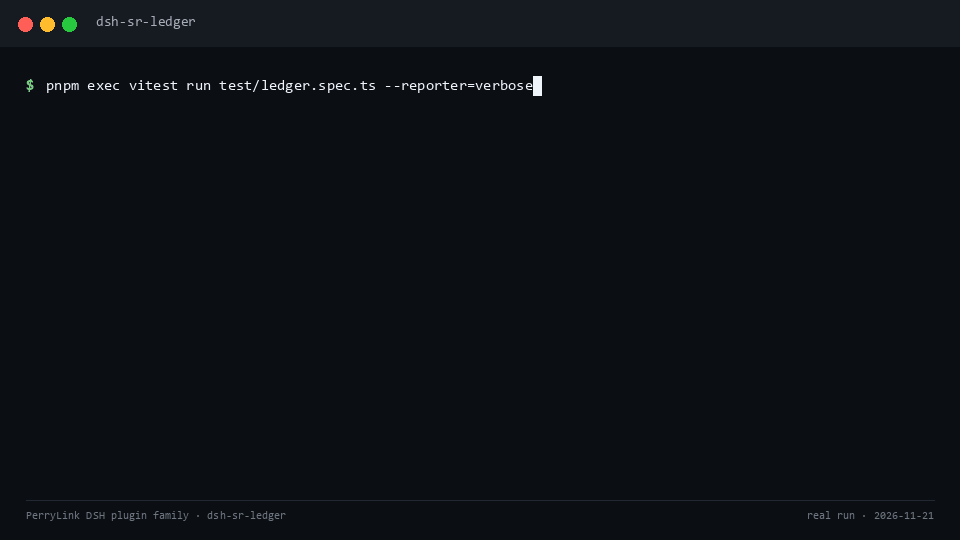

<div align="center">

<picture>
  <source media="(prefers-color-scheme: dark)" srcset="docs/assets/dsh-sr-ledger-hero-en-dark.webp">
  
</picture>

# dsh-sr-ledger

**Un registro de revisión sistemática que sobrevive a la revisión: solo-anexar, doble cribado, PRISMA 2020, verificable por auditoría.**

*Registra el protocolo, cada decisión de cribado con revisor y etapa, las adjudicaciones de conflictos y las evaluaciones RoB/GRADE — y después deriva el flujo PRISMA y exporta la tabla de evidencia. Nada se resuelve en silencio.*

Última verificación: DeepSeek Harness `dsh-v0.2.3-alpha.1` (2026-11-22).

[English](README.md) · [简体中文](README-zh.md) · [Português](README-pt.md) · [हिन्दी](README-hi.md)

[](LICENSE)
[]()

</div>

---

## Qué hace

- **`sr_init`** — crea o revisa el protocolo (PICO, criterios de inclusión/exclusión, recuentos de identificación por fuente, cajas PRISMA manuales) e importa registros (deduplicados por DOI/PMID/arXiv/título). Cada llamada es una nueva revisión más un evento de auditoría; la revisión completa también se anexa a `review-history.jsonl`, de modo que los criterios bajo los que se tomó una decisión siguen siendo reconstruibles.
- **`sr_import`** — importa exportaciones RIS / BibTeX / CSL-JSON / CSV (contenido en línea o una ruta de `ctx.fs`). Los registros analizados pasan por el mismo camino de `sr_init`, así que la deduplicación, el aumento de revisión y la auditoría se comportan igual. Las entradas sin título se omiten y se cuentan; nunca busca ni descarga.
- **`sr_screen`** — registra `include`/`exclude` en `title-abstract` o `full-text`. Que dos revisores no coincidan es un **conflicto**; solo un `adjudicator` puede resolverlo, y solo cuando existe un conflicto. Las exclusiones exigen un motivo. Las evaluaciones RoB 2 / ROBINS-I / GRADE se adjuntan al mismo registro.
- **`sr_prisma`** — deriva los recuentos PRISMA 2020, verifica el registro de auditoría encadenado por hash, enumera los problemas de integridad y escribe `prisma.json`, `prisma.md`, `evidence-table.md` y `ledger.json` bajo `<root>/exports`.

<picture>
  <source media="(prefers-color-scheme: dark)" srcset="docs/assets/dsh-sr-ledger-flow-v5-dark.svg">
  
</picture>

*Estructura: protocolo → cribado → derivación; `counts` e `integrity` son las dos salidas, un conflicto sigue abierto hasta que actúa un adjudicador, y cada revisión del protocolo va encadenada por hash. Las etiquetas del diagrama son los nombres reales de herramientas, campos y archivos de exportación, así que la misma imagen sirve para los cinco idiomas.*

## Qué no hace

- **Sin búsqueda ni recuperación.** Importa registros desde exportaciones de paper-search / Zotero / PubMed.
- **Sin lectura de texto completo.** Las decisiones de cribado son juicios humanos; el registro las conserva.
- **Sin meta-análisis.** Los tamaños de efecto y la agrupación pertenecen a `dsh-meta-analysis`.
- **Sin resolución automática de conflictos.** Un conflicto sigue abierto hasta que actúa un adjudicador.
- **Sin automatización del riesgo de sesgo.** Almacena y resume evaluaciones; no las infiere de un artículo.

## Cajas PRISMA

| Caja | Origen |
|---|---|
| Registros identificados | `identification` por fuente (manual; alternativa = registros importados, etiquetada en el informe) |
| Duplicados eliminados | `manual.duplicatesRemoved` |
| Registros cribados | identificados − duplicados |
| Excluidos en título/resumen | derivado de las decisiones finales |
| Informes buscados para recuperación | inclusión final en título/resumen |
| Informes no recuperados | `manual.recordsNotRetrieved` |
| Evaluados para elegibilidad | buscados − no recuperados |
| Excluidos a texto completo (+ motivos) | derivado; los motivos son obligatorios |
| Estudios incluidos | inclusión final a texto completo |
| Informes de estudios incluidos | `manual.reportsOfIncludedStudies` (por defecto = incluidos) |

## Problemas de integridad (nunca ocultos)

`unknown_record`, `exclude_without_reason`, `adjudication_without_conflict`, `duplicate_decision`, `full_text_without_ta_include`, `open_conflicts`, `identification_counts_missing`, `no_records`, `included_without_assessment`, `assessment_of_excluded` — más los fallos de la cadena de auditoría de `sr_prisma.integrity`. Los errores hacen honesta la exportación; las advertencias se muestran en el Markdown.

## Herramientas

### `sr_init`

`{ title?, pico?, criteria?, identification?, manual?, records? }` → `{ ok, review, imported: {added, skipped}, recordCount }`.

### `sr_import`

`{ content | path, format?, title?, identification?, manual? }`. `format` se detecta por defecto (`ris` / `bibtex` / `csl-json` / `csv`); `path` necesita `ctx.fs`. Devuelve `{ ok, format, parsed, skipped, imported: { added, skipped }, recordCount, warnings, review }`. Un archivo sin ningún título utilizable falla como `EMPTY_IMPORT` en lugar de importar nada en silencio.

### `sr_screen`

`{ recordId, reviewer, stage, decision, reason?, role?, assessment? }` → `{ ok, state, openConflicts, assessment? }`.

### `sr_prisma`

`{}` → `{ ok, counts, issues, robSummary, integrity, exports }`.

### Códigos de error

`INVALID_INPUT` · `NOT_INITIALIZED` · `RECORD_UNKNOWN` · `NO_CONFLICT` · `IO`

## Compatibilidad e instalación

| | |
|---|---|
| DeepSeek Harness | **`dsh-v0.2.2-rc.4`** (verificado el 2026-11-18); peer `>=0.2.2-0 <0.3.0 \|\| >=0.2.2-0 <0.3.0` |
| Node | `^22.19.0 \|\| >=24.9.0` (probado en `24.22.1`), solo ESM |
| Peers | `@perrylink/dsh-research-core ^0.1.0`, `@deepseek-ai/cordis ^4.0.5-alpha.1`, `@deepseek-ai/dsh-tools`, `@deepseek-ai/schemastery ^3.18.5-alpha.1` |
| Dependencias de ejecución | **cero** |

```sh
dsh plugin --profile <name> add @perrylink/dsh-research-core dsh-sr-ledger
dsh --profile <name> --dump-config | grep dsh-sr-ledger
```

## Configuración

| Clave | Valor por defecto | Significado |
|---|---|---|
| `enabled` | `true` | `false` no monta nada |
| `root` | `.sr-ledger` | raíz del registro (`review.json`, `review-history.jsonl`, journals, `exports/`) |

## Límites de seguridad

- Solo local: sin llamadas de red, sin telemetría.
- Journals de solo-anexar; cada revisión del protocolo se conserva en `review-history.jsonl` antes de actualizar `review.json`.
- Los eventos de auditoría van encadenados por hash con los ayudantes del core REP; `sr_prisma` verifica la cadena.
- Sin tratamiento de datos personales más allá de los nombres de revisor que aporte el usuario (usa identificadores, no datos personales).

## Evaluación



*Animado: la salida real de `pnpm exec vitest run test/ledger.spec.ts` el 2026-11-21 — el spec de invariantes del registro, uno de los cuatro archivos de spec de este repositorio. Los marcadores de aprobado y los tiempos se omiten; los nombres de caso y las líneas de resumen son literales.*

**27 pruebas**: revisión del protocolo, historial completo de revisiones y deduplicación, rechazo de registros inválidos, creación de conflictos de doble cribado, resolución solo por adjudicación, exigencia de motivo de exclusión, rechazo de adjudicación sin conflicto, rechazo de registros desconocidos, rechazo atómico de una evaluación/rol inválidos, registro RoB/GRADE, derivación de recuentos PRISMA, contenido del paquete de exportación, detección de manipulación de la cadena de auditoría, mapeo de IO, esquemas de herramientas y ejecución de extremo a extremo, contrato del paquete.

No se declara ningún benchmark: el registro es contabilidad con invariantes explícitos, no un detector. Los invariantes son las pruebas.

## Limitaciones conocidas (v0.1)

- Una revisión por `root`; varias revisiones necesitan varias configuraciones de profile o varias raíces.
- Los recuentos de `identification` son manuales; el plugin no busca.
- Sin variante PRISMA-for-individual-studies, sin gráficos forest, sin tablas GRADE de perfil de evidencia.
- La identidad del revisor es la que aporte quien llama; no hay autenticación.

## Licencia

Apache-2.0. Sin código de terceros en tiempo de ejecución.
