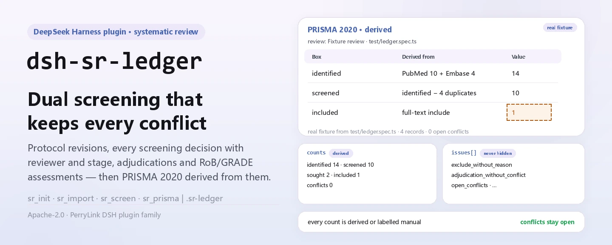
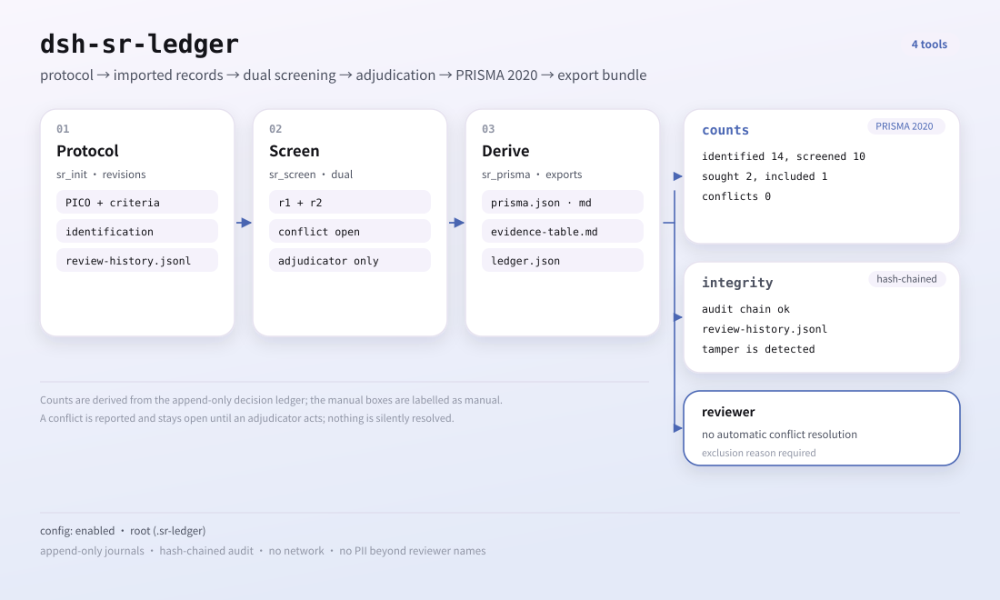
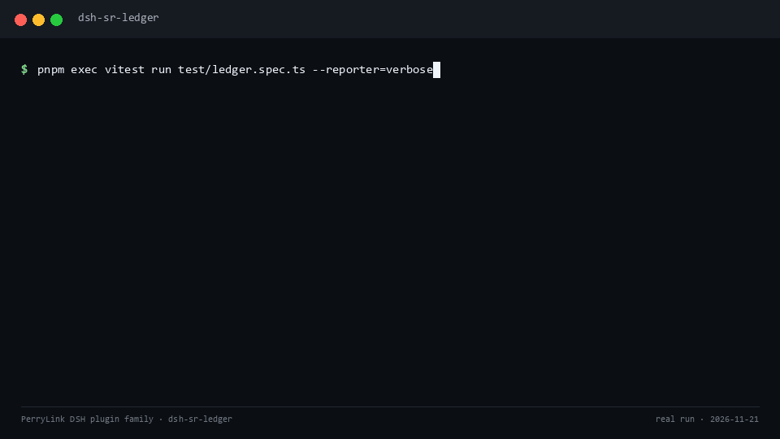

<div align="center">

<picture>
  <source media="(prefers-color-scheme: dark)" srcset="docs/assets/dsh-sr-ledger-hero-en-dark.webp">
  
</picture>

# dsh-sr-ledger

**समीक्षा में टिकने वाला व्यवस्थित-समीक्षा लेजर: केवल-जोड़ना, दोहरी स्क्रीनिंग, PRISMA 2020, ऑडिट से सत्यापन-योग्य।**

*प्रोटोकॉल, समीक्षक और चरण सहित हर स्क्रीनिंग निर्णय, संघर्षों का निपटान और RoB/GRADE मूल्यांकन दर्ज करता है — फिर PRISMA प्रवाह व्युत्पन्न करता है और एविडेंस तालिका निर्यात करता है। कुछ भी चुपचाप सुलझाया नहीं जाता।*

[English](README.md) · [简体中文](README-zh.md) · [Español](README-es.md) · [Português](README-pt.md)

[](LICENSE)
[]()

</div>

---

## यह क्या करता है

- **`sr_init`** — प्रोटोकॉल बनाता/संशोधित करता है (PICO, समावेश/बहिष्करण मानदंड, प्रति-स्रोत पहचान गणनाएँ, मैनुअल PRISMA बॉक्स) और रिकॉर्ड आयात करता है (DOI/PMID/arXiv/शीर्षक से डुप्लिकेट हटाकर)। हर कॉल एक नया रिवीजन और एक ऑडिट इवेंट है; पूरा रिवीजन `review-history.jsonl` में भी जोड़ा जाता है, इसलिए जिस मानदंड के तहत कोई निर्णय लिया गया वह पुनर्निर्माण-योग्य रहता है।
- **`sr_import`** — RIS / BibTeX / CSL-JSON / CSV निर्यात आयात करता है (इनलाइन सामग्री या `ctx.fs` पथ)। पार्स किए गए रिकॉर्ड उसी `sr_init` रास्ते से जाते हैं, इसलिए डुप्लिकेट हटाना, रिवीजन बढ़ाना और ऑडिट एक जैसा व्यवहार करते हैं। बिना शीर्षक वाली प्रविष्टियाँ छोड़ी और गिनी जाती हैं; यह कभी खोजता या डाउनलोड नहीं करता।
- **`sr_screen`** — `title-abstract` या `full-text` पर `include`/`exclude` दर्ज करता है। दो समीक्षकों का असहमत होना = **संघर्ष**; इसे केवल एक `adjudicator` सुलझा सकता है, और केवल तब जब संघर्ष मौजूद हो। बहिष्करण के लिए कारण ज़रूरी है। RoB 2 / ROBINS-I / GRADE मूल्यांकन उसी लेजर से जुड़ते हैं।
- **`sr_prisma`** — PRISMA 2020 गणनाएँ व्युत्पन्न करता है, हैश-चेन ऑडिट लॉग सत्यापित करता है, इंटीग्रिटी समस्याएँ सूचीबद्ध करता है, और `<root>/exports` के अंतर्गत `prisma.json`, `prisma.md`, `evidence-table.md`, `ledger.json` लिखता है।


<picture>
  <source media="(prefers-color-scheme: dark)" srcset="docs/assets/dsh-sr-ledger-flow-v5-dark.svg">
  
</picture>

*संरचना: प्रोटोकॉल → स्क्रीनिंग → व्युत्पत्ति; `counts` और `integrity` दो आउटपुट हैं, संघर्ष तब तक खुला रहता है जब तक adjudicator कार्रवाई न करे, और प्रोटोकॉल का हर रिवीजन हैश-चेन में जुड़ता है। डायग्राम के अंदर केवल असली टूल नाम, फ़ील्ड नाम और निर्यात फ़ाइलें हैं, इसलिए एक ही चित्र पाँचों भाषाओं के लिए काम आता है।*

## यह क्या नहीं करता

- **कोई खोज या पुनर्प्राप्ति नहीं।** रिकॉर्ड paper-search / Zotero / PubMed के निर्यात से आयात करें।
- **पूरा पाठ पढ़ना नहीं।** स्क्रीनिंग निर्णय मानवीय निर्णय हैं; लेजर उन्हें दर्ज करता है।
- **मेटा-विश्लेषण नहीं।** इफ़ेक्ट साइज़ और पूलिंग `dsh-meta-analysis` का काम है।
- **संघर्षों का स्वचालित समाधान नहीं।** संघर्ष तब तक खुला रहता है जब तक adjudicator कार्रवाई न करे।
- **पूर्वाग्रह-जोखिम का स्वचालन नहीं।** यह मूल्यांकन संग्रहीत और सारांशित करता है; किसी पेपर से उनका अनुमान नहीं लगाता।

## PRISMA बॉक्स

| बॉक्स | स्रोत |
|---|---|
| पहचाने गए रिकॉर्ड | प्रति स्रोत `identification` (मैनुअल; विकल्प = आयातित रिकॉर्ड, रिपोर्ट में लेबल किया गया) |
| हटाए गए डुप्लिकेट | `manual.duplicatesRemoved` |
| स्क्रीन किए गए रिकॉर्ड | पहचाने गए − डुप्लिकेट |
| शीर्षक/सारांश पर बहिष्कृत | अंतिम निर्णयों से व्युत्पन्न |
| पुनर्प्राप्ति के लिए माँगी गई रिपोर्टें | अंतिम शीर्षक/सारांश समावेशन |
| पुनर्प्राप्त न हुई रिपोर्टें | `manual.recordsNotRetrieved` |
| पात्रता के लिए मूल्यांकित | माँगी गई − पुनर्प्राप्त न हुई |
| पूर्ण पाठ पर बहिष्कृत (+ कारण) | व्युत्पन्न; कारण अनिवार्य |
| शामिल अध्ययन | अंतिम पूर्ण-पाठ समावेशन |
| शामिल अध्ययनों की रिपोर्टें | `manual.reportsOfIncludedStudies` (डिफ़ॉल्ट = शामिल) |

## इंटीग्रिटी समस्याएँ (कभी छिपाई नहीं जातीं)

`unknown_record`, `exclude_without_reason`, `adjudication_without_conflict`, `duplicate_decision`, `full_text_without_ta_include`, `open_conflicts`, `identification_counts_missing`, `no_records`, `included_without_assessment`, `assessment_of_excluded` — और `sr_prisma.integrity` से ऑडिट-चेन विफलताएँ। error निर्यात को ईमानदार बनाते हैं; warning Markdown में दिखाए जाते हैं।

## टूल

### `sr_init`

`{ title?, pico?, criteria?, identification?, manual?, records? }` → `{ ok, review, imported: {added, skipped}, recordCount }`.

### `sr_import`

`{ content | path, format?, title?, identification?, manual? }`. `format` डिफ़ॉल्ट रूप से पहचाना जाता है (`ris` / `bibtex` / `csl-json` / `csv`); `path` के लिए `ctx.fs` चाहिए। लौटाता है `{ ok, format, parsed, skipped, imported: { added, skipped }, recordCount, warnings, review }`. किसी भी उपयोगी शीर्षक के बिना फ़ाइल चुपचाप कुछ भी आयात करने के बजाय `EMPTY_IMPORT` के रूप में विफल होती है।

### `sr_screen`

`{ recordId, reviewer, stage, decision, reason?, role?, assessment? }` → `{ ok, state, openConflicts, assessment? }`.

### `sr_prisma`

`{}` → `{ ok, counts, issues, robSummary, integrity, exports }`.

### त्रुटि कोड

`INVALID_INPUT` · `NOT_INITIALIZED` · `RECORD_UNKNOWN` · `NO_CONFLICT` · `IO`

## अनुकूलता और इंस्टॉल

| | |
|---|---|
| DeepSeek Harness | **`dsh-v0.2.2-rc.4`** (2026-11-18 को सत्यापित); peer `>=0.2.1-0 <0.3.0 \|\| >=0.2.2-0 <0.3.0` |
| Node | `^22.19.0 \|\| >=24.9.0` (`24.22.1` पर परीक्षित), केवल ESM |
| Peers | `@perrylink/dsh-research-core ^0.1.0`, `@deepseek-ai/cordis ^4.0.5-alpha.1`, `@deepseek-ai/dsh-tools`, `@deepseek-ai/schemastery ^3.18.5-alpha.1` |
| रनटाइम निर्भरताएँ | **शून्य** |

```sh
dsh plugin --profile <name> add @perrylink/dsh-research-core dsh-sr-ledger
dsh --profile <name> --dump-config | grep dsh-sr-ledger
```

## कॉन्फ़िगरेशन

| कुंजी | डिफ़ॉल्ट | अर्थ |
|---|---|---|
| `enabled` | `true` | `false` होने पर कुछ भी माउंट नहीं होता |
| `root` | `.sr-ledger` | लेजर रूट (`review.json`, `review-history.jsonl`, journals, `exports/`) |

## सुरक्षा सीमाएँ

- केवल स्थानीय: कोई नेटवर्क कॉल नहीं, कोई टेलीमेट्री नहीं।
- केवल-जोड़ने वाले journals; `review.json` अपडेट होने से पहले हर प्रोटोकॉल रिवीजन `review-history.jsonl` में सुरक्षित रहता है।
- ऑडिट इवेंट REP core helpers से हैश-चेन में जुड़ते हैं; `sr_prisma` उस चेन को सत्यापित करता है।
- उपयोगकर्ता द्वारा दिए गए समीक्षक नामों से आगे कोई व्यक्तिगत डेटा प्रसंस्करण नहीं (पहचानकर्ता इस्तेमाल करें, व्यक्तिगत डेटा नहीं)।

## मूल्यांकन



*एनिमेटेड: 2026-11-21 को `pnpm exec vitest run test/ledger.spec.ts` का असली आउटपुट — लेजर इनवेरिएंट spec, इस रिपॉज़िटरी की चार spec फ़ाइलों में से एक। पास मार्कर और समय हटा दिए गए हैं; केस नाम और सारांश पंक्तियाँ जस की तस हैं।*

**16 टेस्ट**: प्रोटोकॉल रिवीजन, पूरा रिवीजन इतिहास और डुप्लिकेट हटाना, अमान्य रिकॉर्ड अस्वीकृति, दोहरी-स्क्रीनिंग संघर्ष निर्माण, केवल-adjudication समाधान, बहिष्करण-कारण अनिवार्यता, संघर्ष के बिना adjudication अस्वीकृति, अज्ञात रिकॉर्ड अस्वीकृति, अमान्य assessment/role की परमाणु अस्वीकृति, RoB/GRADE रिकॉर्डिंग, PRISMA गणना व्युत्पत्ति, निर्यात बंडल की सामग्री, ऑडिट-चेन छेड़छाड़ पकड़ना, IO मैपिंग, टूल स्कीमा और एंड-टू-एंड निष्पादन, पैकेज कॉन्ट्रैक्ट।

कोई बेंचमार्क दावा नहीं किया जाता: यह लेजर स्पष्ट इनवेरिएंट वाला बहीखाता है, कोई डिटेक्टर नहीं। इनवेरिएंट ही टेस्ट हैं।

## ज्ञात सीमाएँ (v0.1)

- प्रति `root` एक समीक्षा; कई समीक्षाओं के लिए कई profile कॉन्फ़िग या कई रूट चाहिए।
- `identification` गणनाएँ मैनुअल हैं; प्लगइन खोज नहीं करता।
- PRISMA-for-individual-studies संस्करण नहीं, फ़ॉरेस्ट प्लॉट नहीं, GRADE एविडेंस-प्रोफ़ाइल तालिकाएँ नहीं।
- समीक्षक की पहचान वही है जो कॉलर देता है; कोई प्रमाणीकरण नहीं।

## लाइसेंस

Apache-2.0. रनटाइम में कोई तृतीय-पक्ष कोड नहीं।
