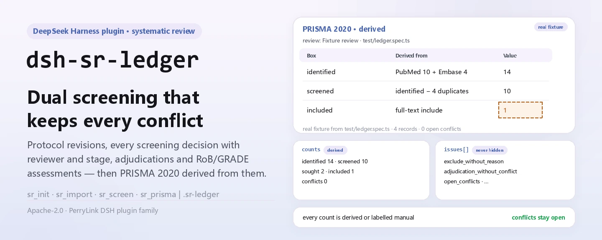
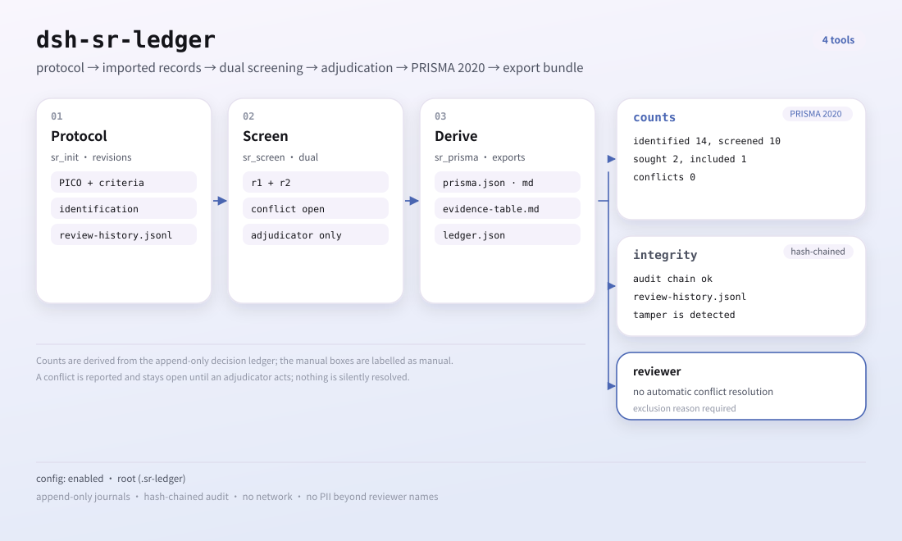
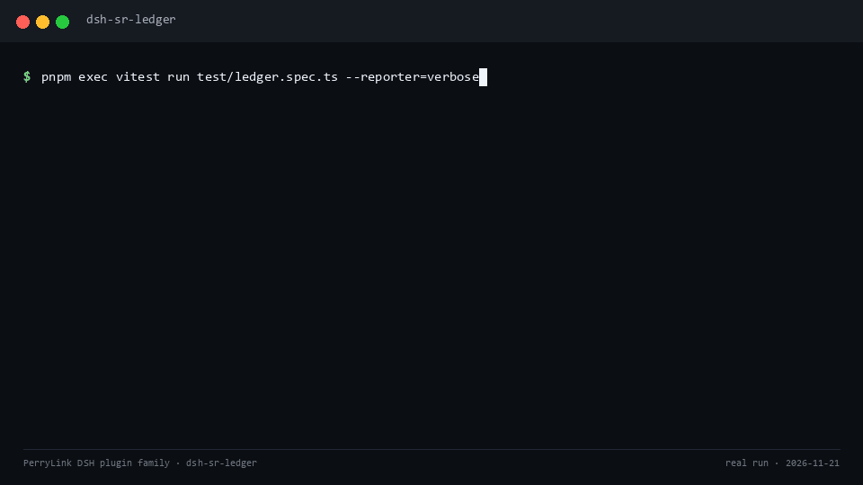

<div align="center">

<picture>
  <source media="(prefers-color-scheme: dark)" srcset="docs/assets/dsh-sr-ledger-hero-en-dark.webp">
  
</picture>

# dsh-sr-ledger

**Um registro de revisão sistemática que sobrevive à revisão: somente-anexação, dupla triagem, PRISMA 2020, verificável por auditoria.**

*Registra o protocolo, cada decisão de triagem com revisor e etapa, as adjudicações de conflitos e as avaliações RoB/GRADE — e então deriva o fluxo PRISMA e exporta a tabela de evidências. Nada é resolvido em silêncio.*

Última verificação: DeepSeek Harness `dsh-v0.2.3-alpha.1` (2026-11-22).

[English](README.md) · [简体中文](README-zh.md) · [Español](README-es.md) · [हिन्दी](README-hi.md)

[](LICENSE)
[]()

</div>

---

## O que ele faz

- **`sr_init`** — cria/revê o protocolo (PICO, critérios de inclusão/exclusão, contagens de identificação por fonte, caixas PRISMA manuais) e importa registros (deduplicados por DOI/PMID/arXiv/título). Cada chamada é uma nova revisão mais um evento de auditoria; a revisão completa também é anexada a `review-history.jsonl`, de modo que os critérios sob os quais uma decisão foi tomada continuam reconstruíveis.
- **`sr_import`** — importa exportações RIS / BibTeX / CSL-JSON / CSV (conteúdo inline ou um caminho de `ctx.fs`). Os registros analisados passam pelo mesmo caminho de `sr_init`, então deduplicação, aumento de revisão e auditoria se comportam de forma idêntica. Entradas sem título são ignoradas e contadas; ele nunca busca nem baixa nada.
- **`sr_screen`** — registra `include`/`exclude` em `title-abstract` ou `full-text`. Dois revisores discordando = **conflito**; apenas um `adjudicator` pode resolvê-lo, e apenas quando existe um conflito. Exclusões exigem um motivo. Avaliações RoB 2 / ROBINS-I / GRADE ficam anexadas ao mesmo registro.
- **`sr_prisma`** — deriva as contagens PRISMA 2020, verifica o log de auditoria encadeado por hash, lista os problemas de integridade e escreve `prisma.json`, `prisma.md`, `evidence-table.md` e `ledger.json` em `<root>/exports`.

<picture>
  <source media="(prefers-color-scheme: dark)" srcset="docs/assets/dsh-sr-ledger-flow-v5-dark.svg">
  
</picture>

*Estrutura: protocolo → triagem → derivação; `counts` e `integrity` são as duas saídas, um conflito permanece aberto até que um adjudicador atue, e cada revisão do protocolo é encadeada por hash. Os rótulos do diagrama são os nomes reais de ferramentas, campos e arquivos de exportação, então a mesma imagem serve aos cinco idiomas.*

## O que ele não faz

- **Sem busca ou recuperação.** Importe registros de exportações do paper-search / Zotero / PubMed.
- **Sem leitura de texto completo.** As decisões de triagem são julgamentos humanos; o registro apenas as guarda.
- **Sem meta-análise.** Tamanhos de efeito e agrupamento pertencem ao `dsh-meta-analysis`.
- **Sem resolução automática de conflitos.** Um conflito permanece aberto até que um adjudicador atue.
- **Sem automação de risco de viés.** Ele armazena e resume avaliações; não as infere de um artigo.

## Caixas PRISMA

| Caixa | Origem |
|---|---|
| Registros identificados | `identification` por fonte (manual; alternativa = registros importados, rotulada no relatório) |
| Duplicatas removidas | `manual.duplicatesRemoved` |
| Registros triados | identificados − duplicatas |
| Excluídos em título/resumo | derivado das decisões finais |
| Relatórios buscados para recuperação | inclusões finais em título/resumo |
| Relatórios não recuperados | `manual.recordsNotRetrieved` |
| Avaliados para elegibilidade | buscados − não recuperados |
| Excluídos em texto completo (+ motivos) | derivado; motivos obrigatórios |
| Estudos incluídos | inclusões finais em texto completo |
| Relatórios de estudos incluídos | `manual.reportsOfIncludedStudies` (padrão = incluídos) |

## Problemas de integridade (nunca ocultos)

`unknown_record`, `exclude_without_reason`, `adjudication_without_conflict`, `duplicate_decision`, `full_text_without_ta_include`, `open_conflicts`, `identification_counts_missing`, `no_records`, `included_without_assessment`, `assessment_of_excluded` — mais falhas da cadeia de auditoria vindas de `sr_prisma.integrity`. Erros tornam a exportação honesta; avisos aparecem no Markdown.

## Ferramentas

### `sr_init`

`{ title?, pico?, criteria?, identification?, manual?, records? }` → `{ ok, review, imported: {added, skipped}, recordCount }`.

### `sr_import`

`{ content | path, format?, title?, identification?, manual? }`. `format` é detectado por padrão (`ris` / `bibtex` / `csl-json` / `csv`); `path` precisa de `ctx.fs`. Retorna `{ ok, format, parsed, skipped, imported: { added, skipped }, recordCount, warnings, review }`. Um arquivo sem nenhum título utilizável falha como `EMPTY_IMPORT` em vez de importar nada em silêncio.

### `sr_screen`

`{ recordId, reviewer, stage, decision, reason?, role?, assessment? }` → `{ ok, state, openConflicts, assessment? }`.

### `sr_prisma`

`{}` → `{ ok, counts, issues, robSummary, integrity, exports }`.

### Códigos de erro

`INVALID_INPUT` · `NOT_INITIALIZED` · `RECORD_UNKNOWN` · `NO_CONFLICT` · `IO`

## Compatibilidade e instalação

| | |
|---|---|
| DeepSeek Harness | **`dsh-v0.2.2-rc.4`** (verificado em 2026-11-18); peer `>=0.2.1-0 <0.3.0 \|\| >=0.2.2-0 <0.3.0` |
| Node | `^22.19.0 \|\| >=24.9.0` (testado em `24.22.1`), somente ESM |
| Peers | `@perrylink/dsh-research-core ^0.1.0`, `@deepseek-ai/cordis ^4.0.5-alpha.1`, `@deepseek-ai/dsh-tools`, `@deepseek-ai/schemastery ^3.18.5-alpha.1` |
| Dependências de execução | **zero** |

```sh
dsh plugin --profile <name> add @perrylink/dsh-research-core dsh-sr-ledger
dsh --profile <name> --dump-config | grep dsh-sr-ledger
```

## Configuração

| Chave | Padrão | Significado |
|---|---|---|
| `enabled` | `true` | `false` não monta nada |
| `root` | `.sr-ledger` | raiz do registro (`review.json`, `review-history.jsonl`, journals, `exports/`) |

## Limites de segurança

- Somente local: sem chamadas de rede, sem telemetria.
- Journals somente-anexação; cada revisão do protocolo é preservada em `review-history.jsonl` antes de `review.json` ser atualizado.
- Os eventos de auditoria são encadeados por hash com os auxiliares do core REP; o `sr_prisma` verifica a cadeia.
- Nenhum tratamento de dados pessoais além dos nomes de revisor fornecidos pelo usuário (use identificadores, não dados pessoais).

## Avaliação



*Animado: a saída real de `pnpm exec vitest run test/ledger.spec.ts` em 2026-11-21 — o spec de invariantes do registro, um dos quatro arquivos de spec deste repositório. Marcadores de aprovação e tempos foram omitidos; os nomes dos casos e as linhas de resumo são literais.*

**27 testes**: revisão do protocolo, histórico completo de revisões e deduplicação, rejeição de registros inválidos, criação de conflito de dupla triagem, resolução apenas por adjudicação, exigência de motivo de exclusão, rejeição de adjudicação sem conflito, rejeição de registros desconhecidos, rejeição atômica de avaliação/papel inválidos, registro RoB/GRADE, derivação de contagens PRISMA, conteúdo do pacote de exportação, detecção de adulteração da cadeia de auditoria, mapeamento de IO, esquemas de ferramentas e execução de ponta a ponta, contrato do pacote.

Nenhum benchmark é alegado: o registro é contabilidade com invariantes explícitos, não um detector. Os invariantes são os testes.

## Limitações conhecidas (v0.1)

- Uma revisão por `root`; várias revisões exigem várias configurações de profile ou várias raízes.
- As contagens de `identification` são manuais; o plugin não busca.
- Sem variante PRISMA-for-individual-studies, sem gráficos de floresta, sem tabelas GRADE de perfil de evidência.
- A identidade do revisor é o que o chamador fornecer; não há autenticação.

## Licença

Apache-2.0. Nenhum código de terceiros em tempo de execução.
