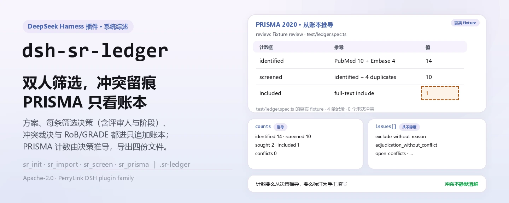
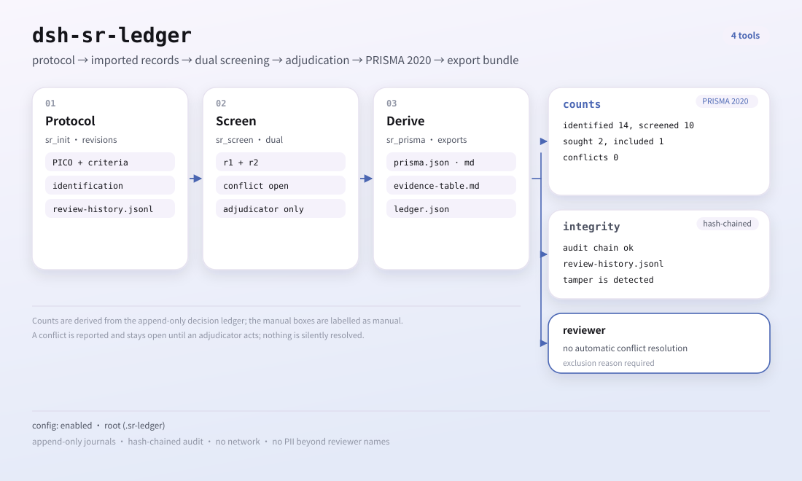
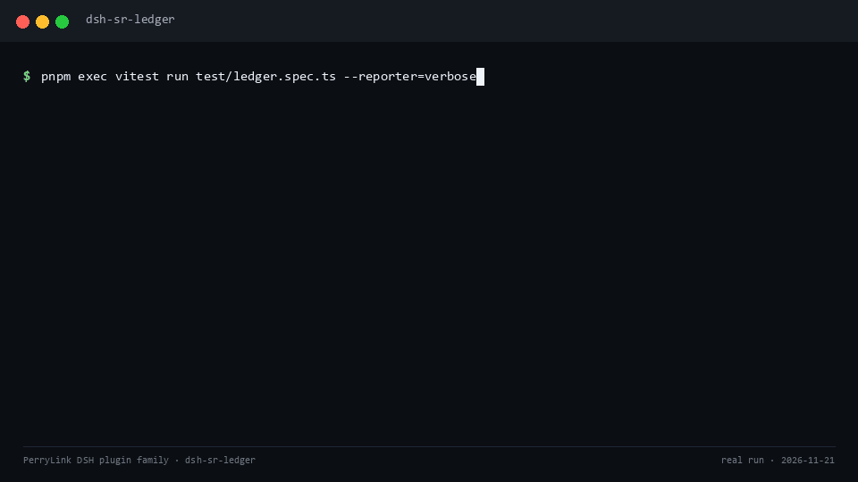

<div align="center">

<picture>
  <source media="(prefers-color-scheme: dark)" srcset="docs/assets/dsh-sr-ledger-hero-zh-dark.webp">
  
</picture>

# dsh-sr-ledger

**经得起复核的系统综述账本：只追加、双人筛选、PRISMA 2020、审计可验。**

*记录方案、每条筛选决策（含评审人与阶段）、冲突裁决与 RoB/GRADE 评估，再推导 PRISMA 流程并导出证据表。任何事项都不会被静默消解。*

最近一次核验：DeepSeek Harness `dsh-v0.2.3-alpha.1`（2026-11-22）。

[English](README.md) · [Español](README-es.md) · [Português](README-pt.md) · [हिन्दी](README-hi.md)

[](LICENSE)
[]()

</div>

---

## 它做什么

- **`sr_init`** —— 创建/修订方案（PICO、纳入/排除标准、各来源的识别数、手工 PRISMA 框），并导入记录（按 DOI/PMID/arXiv/标题去重）。每次调用都会产生一个新修订和一个审计事件；完整修订还会追加到 `review-history.jsonl`，因此某条决策所依据的标准始终可以还原。
- **`sr_import`** —— 导入 RIS / BibTeX / CSL-JSON / CSV 导出（内联内容或 `ctx.fs` 路径）。解析出的记录走同一条 `sr_init` 路径，因此去重、修订号与审计行为完全一致。没有标题的条目会被跳过并计数；它不检索、不抓取。
- **`sr_screen`** —— 在 `title-abstract` 或 `full-text` 阶段记录 `include`/`exclude`。两名评审意见不一致即构成**冲突**；只有 `adjudicator` 能裁决，而且只在冲突确实存在时才能裁决。排除必须给出理由。RoB 2 / ROBINS-I / GRADE 评估也记在同一账本中。
- **`sr_prisma`** —— 推导 PRISMA 2020 计数，校验哈希链式审计日志，列出完整性问题，并把 `prisma.json`、`prisma.md`、`evidence-table.md`、`ledger.json` 写入 `<root>/exports`。

<picture>
  <source media="(prefers-color-scheme: dark)" srcset="docs/assets/dsh-sr-ledger-flow-v5-dark.svg">
  
</picture>

*结构：方案 → 筛选 → 推导；`counts` 与 `integrity` 是两条输出，冲突在裁决人处理前一直开启，每次方案修订都做哈希链接。图内只有真实的工具名、字段名与导出文件名，五语共用同一张结构图。*

## 它不做什么

- **不检索、不抓取。** 记录从 paper-search / Zotero / PubMed 的导出文件导入。
- **不阅读全文。** 筛选决策由人判断，账本只负责记录。
- **不做 meta 分析。** 效应量与合并属于 `dsh-meta-analysis`。
- **不自动消解冲突。** 冲突会一直保持开启，直到裁决人处理。
- **不自动做偏倚风险评估。** 它只存储并汇总评估结果，不从论文中推断。

## PRISMA 计数框

| 计数框 | 来源 |
|---|---|
| 识别到的记录 | 各来源的 `identification`（手工填写；回退值 = 导入的记录，并在报告中标注） |
| 去除的重复记录 | `manual.duplicatesRemoved` |
| 筛选的记录 | 识别数 − 重复数 |
| 题名/摘要阶段排除 | 由最终决策推导 |
| 拟获取全文的报告 | 最终 title-abstract 阶段纳入 |
| 未获取到全文的报告 | `manual.recordsNotRetrieved` |
| 进入合格性评估的报告 | 拟获取数 − 未获取数 |
| 全文阶段排除（+ 理由） | 推导得出；必须给出理由 |
| 纳入的研究 | 全文阶段最终纳入 |
| 纳入研究的报告 | `manual.reportsOfIncludedStudies`（默认 = 纳入数） |

## 完整性问题（从不隐藏）

`unknown_record`、`exclude_without_reason`、`adjudication_without_conflict`、`duplicate_decision`、`full_text_without_ta_include`、`open_conflicts`、`identification_counts_missing`、`no_records`、`included_without_assessment`、`assessment_of_excluded` —— 以及来自 `sr_prisma.integrity` 的审计链失败。error 会让导出保持诚实；warning 会在 Markdown 中呈现。

## 工具

### `sr_init`

`{ title?, pico?, criteria?, identification?, manual?, records? }` → `{ ok, review, imported: {added, skipped}, recordCount }`。

### `sr_import`

`{ content | path, format?, title?, identification?, manual? }`。`format` 默认自动识别（`ris` / `bibtex` / `csl-json` / `csv`）；`path` 需要 `ctx.fs`。返回 `{ ok, format, parsed, skipped, imported: { added, skipped }, recordCount, warnings, review }`。整份文件都没有可用标题时以 `EMPTY_IMPORT` 失败，而不是静默导入 0 条。

### `sr_screen`

`{ recordId, reviewer, stage, decision, reason?, role?, assessment? }` → `{ ok, state, openConflicts, assessment? }`。

### `sr_prisma`

`{}` → `{ ok, counts, issues, robSummary, integrity, exports }`。

### 错误码

`INVALID_INPUT` · `NOT_INITIALIZED` · `RECORD_UNKNOWN` · `NO_CONFLICT` · `IO`

## 兼容性与安装

| | |
|---|---|
| DeepSeek Harness | **`dsh-v0.2.2-rc.4`**（2026-11-18 实测）；peer `>=0.2.1-0 <0.3.0 \|\| >=0.2.2-0 <0.3.0` |
| Node | `^22.19.0 \|\| >=24.9.0`（实测 `24.22.1`），仅 ESM |
| Peer 依赖 | `@perrylink/dsh-research-core ^0.1.0`、`@deepseek-ai/cordis ^4.0.5-alpha.1`、`@deepseek-ai/dsh-tools`、`@deepseek-ai/schemastery ^3.18.5-alpha.1` |
| 运行时依赖 | **零** |

```sh
dsh plugin --profile <name> add @perrylink/dsh-research-core dsh-sr-ledger
dsh --profile <name> --dump-config | grep dsh-sr-ledger
```

## 配置

| 键 | 默认值 | 含义 |
|---|---|---|
| `enabled` | `true` | `false` 时不挂载任何内容 |
| `root` | `.sr-ledger` | 账本根目录（`review.json`、`review-history.jsonl`、各 journal、`exports/`） |

## 安全边界

- 仅本地运行：不发起网络请求，不上报遥测。
- 只追加 journal；每次方案修订都先保存到 `review-history.jsonl`，再更新 `review.json`。
- 审计事件使用 REP 核心的辅助函数做哈希链；`sr_prisma` 会校验该链。
- 除用户提供的评审人姓名外，不处理任何个人身份信息（请使用标识符，不要使用个人数据）。

## 评测



*动图是 2026-11-21 真实运行的 `pnpm exec vitest run test/ledger.spec.ts` 输出——账本不变量 spec，本仓库四个 spec 文件之一。通过标记与耗时已省略；用例名与汇总行均为原样。*

**27 个测试**：方案修订、完整修订历史与去重、拒绝非法记录、双人筛选产生冲突、冲突只能由裁决消解、强制排除理由、拒绝无冲突的裁决、拒绝未知记录、非法评估/角色会被原子性拒绝、RoB/GRADE 记录、PRISMA 计数推导、导出包内容、审计链篡改检测、IO 映射、工具 schema 与端到端执行、包契约。

不声称基准测试结果：这个账本是一套带显式不变量的记账机制，不是检测器。这些不变量就是测试。

## 已知限制（v0.1）

- 每个 `root` 只支持一个综述；多个综述需要多份 profile 配置或多个 root。
- `identification` 计数需手工填写；插件不执行检索。
- 不支持 PRISMA-for-individual-studies 变体，不生成森林图，也不生成 GRADE 证据概要表。
- 评审人身份完全由调用方提供；没有身份认证。

## 许可

Apache-2.0。运行时不含第三方代码。
