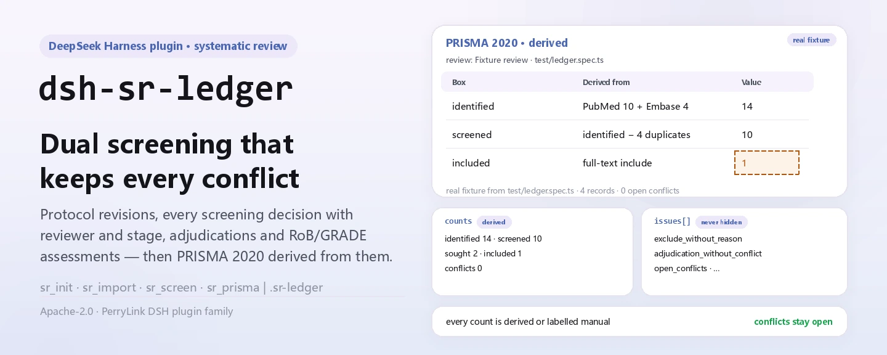
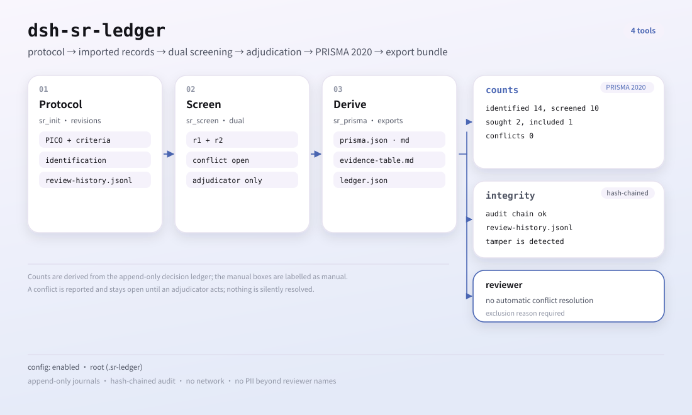
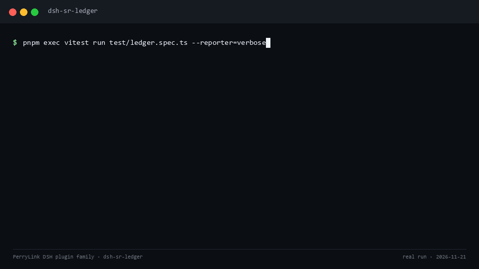

<div align="center">

<picture>
  <source media="(prefers-color-scheme: dark)" srcset="docs/assets/dsh-sr-ledger-hero-en-dark.webp">
  
</picture>

# dsh-sr-ledger

**A systematic-review ledger that survives review: append-only, dual-screened, PRISMA 2020, audit-verifiable.**

*Records the protocol, every screening decision with reviewer and stage, conflict adjudications and RoB/GRADE assessments — then derives the PRISMA flow and exports the evidence table. Nothing is silently resolved.*

[简体中文](README-zh.md) · [Español](README-es.md) · [Português](README-pt.md) · [हिन्दी](README-hi.md)

[](LICENSE)
[]()

</div>

---

## What it does

- **`sr_init`** — create/revise the protocol (PICO, include/exclude criteria, per-source identification counts, manual PRISMA boxes) and import records (deduplicated by DOI/PMID/arXiv/title). Every call is a new revision plus an audit event; the full revision is also appended to `review-history.jsonl`, so the criteria a decision was made under remain reconstructable.
- **`sr_import`** — import RIS / BibTeX / CSL-JSON / CSV exports (inline content or a `ctx.fs` path). Parsed records go through the same `sr_init` path, so dedupe, revision bump and audit behave identically. Entries without a title are skipped and counted; it never searches or fetches.
- **`sr_screen`** — record `include`/`exclude` at `title-abstract` or `full-text`. Two reviewers disagreeing = **conflict**; only an `adjudicator` can settle it, and only when a conflict exists. Exclusions require a reason. RoB 2 / ROBINS-I / GRADE assessments attach to the same ledger.
- **`sr_prisma`** — derive the PRISMA 2020 counts, verify the hash-chained audit log, list integrity issues, and write `prisma.json`, `prisma.md`, `evidence-table.md`, `ledger.json` under `<root>/exports`.


<picture>
  <source media="(prefers-color-scheme: dark)" srcset="docs/assets/dsh-sr-ledger-flow-v5-dark.svg">
  
</picture>

*Structure: protocol → screening → derivation; `counts` and `integrity` are the two outputs, a conflict stays open until an adjudicator acts, and every protocol revision is hash-chained. The token labels inside the diagram are the real tool names, field names and export files, so the same picture serves all five languages.*

## What it does not do

- **No searching or retrieval.** Import records from paper-search / Zotero / PubMed exports.
- **No full-text reading.** Screening decisions are human judgements; the ledger records them.
- **No meta-analysis.** Effect sizes and pooling belong to `dsh-meta-analysis`.
- **No automatic conflict resolution.** A conflict stays open until an adjudicator acts.
- **No risk-of-bias automation.** It stores and summarises assessments; it does not infer them from a paper.

## PRISMA boxes

| Box | Source |
|---|---|
| Records identified | `identification` per source (manual; fallback = imported records, labelled in the report) |
| Duplicates removed | `manual.duplicatesRemoved` |
| Records screened | identified − duplicates |
| Excluded at title/abstract | derived from final decisions |
| Reports sought for retrieval | final TA includes |
| Reports not retrieved | `manual.recordsNotRetrieved` |
| Assessed for eligibility | sought − not retrieved |
| Excluded at full text (+ reasons) | derived; reasons required |
| Studies included | final full-text includes |
| Reports of included studies | `manual.reportsOfIncludedStudies` (default = included) |

## Integrity issues (never hidden)

`unknown_record`, `exclude_without_reason`, `adjudication_without_conflict`, `duplicate_decision`, `full_text_without_ta_include`, `open_conflicts`, `identification_counts_missing`, `no_records`, `included_without_assessment`, `assessment_of_excluded` — plus audit-chain failures from `sr_prisma.integrity`. Errors make the export honest; warnings are surfaced in the Markdown.

## Tools

### `sr_init`

`{ title?, pico?, criteria?, identification?, manual?, records? }` → `{ ok, review, imported: {added, skipped}, recordCount }`.

### `sr_import`

`{ content | path, format?, title?, identification?, manual? }`. `format` defaults to detection (`ris` / `bibtex` / `csl-json` / `csv`); `path` needs `ctx.fs`. Returns `{ ok, format, parsed, skipped, imported: { added, skipped }, recordCount, warnings, review }`. A file with no usable title fails as `EMPTY_IMPORT` instead of importing nothing silently.

### `sr_screen`

`{ recordId, reviewer, stage, decision, reason?, role?, assessment? }` → `{ ok, state, openConflicts, assessment? }`.

### `sr_prisma`

`{}` → `{ ok, counts, issues, robSummary, integrity, exports }`.

### Error codes

`INVALID_INPUT` · `NOT_INITIALIZED` · `RECORD_UNKNOWN` · `NO_CONFLICT` · `IO`

## Compatibility & install

| | |
|---|---|
| DeepSeek Harness | **`dsh-v0.2.2-rc.4`** (verified 2026-11-18); peer `>=0.2.1-0 <0.3.0 \|\| >=0.2.2-0 <0.3.0` |
| Node | `^22.19.0 \|\| >=24.9.0` (tested `24.22.1`), ESM only |
| Peers | `@perrylink/dsh-research-core ^0.1.0`, `@deepseek-ai/cordis ^4.0.5-alpha.1`, `@deepseek-ai/dsh-tools`, `@deepseek-ai/schemastery ^3.18.5-alpha.1` |
| Runtime dependencies | **zero** |

```sh
dsh plugin --profile <name> add @perrylink/dsh-research-core dsh-sr-ledger
dsh --profile <name> --dump-config | grep dsh-sr-ledger
```

## Configuration

| Key | Default | Meaning |
|---|---|---|
| `enabled` | `true` | `false` mounts nothing |
| `root` | `.sr-ledger` | ledger root (`review.json`, `review-history.jsonl`, journals, `exports/`) |

## Security boundaries

- Local only: no network calls, no telemetry.
- Append-only journals; every protocol revision is preserved in `review-history.jsonl` before `review.json` is updated.
- Audit events are hash-chained with the REP core helpers; `sr_prisma` verifies the chain.
- No PII handling beyond reviewer names the user supplies (use identifiers, not personal data).

## Evaluation



*Animated: the real `pnpm exec vitest run test/ledger.spec.ts` output on 2026-11-21 — the ledger invariants spec, one of the four spec files in this repository. Pass markers and timings are omitted; the case names and the summary lines are verbatim.*


**16 tests**: protocol revision, full revision history and dedupe, invalid-record rejection, dual-screening conflict creation, adjudication-only resolution, exclusion-reason enforcement, adjudication-without-conflict rejection, unknown-record rejection, atomic rejection of an invalid assessment/role, RoB/GRADE recording, PRISMA count derivation, export bundle contents, audit-chain tamper detection, IO mapping, tool schemas and end-to-end execution, package contract.

No benchmark is claimed: the ledger is bookkeeping with explicit invariants, not a detector. The invariants are the tests.

## Known limitations (v0.1)

- One review per `root`; multiple reviews need multiple profile configs or roots.
- `identification` counts are manual; the plugin does not search.
- No PRISMA-for-individual-studies variant, no forest plots, no GRADE evidence-profile tables.
- Reviewer identity is whatever the caller supplies; there is no authentication.

## License

Apache-2.0. No third-party runtime code.
